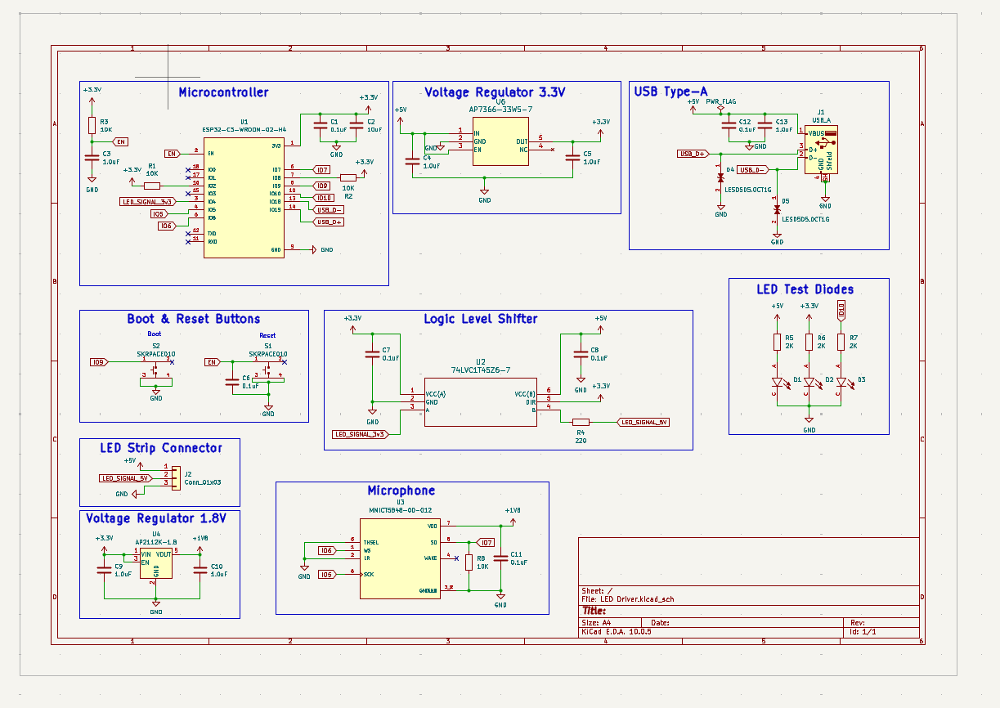
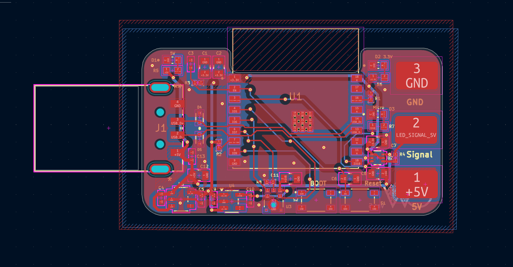
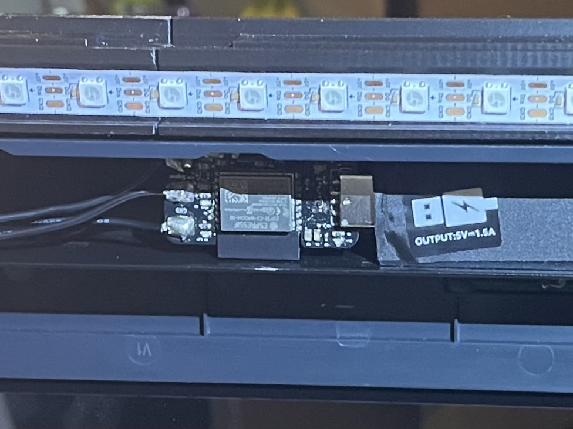
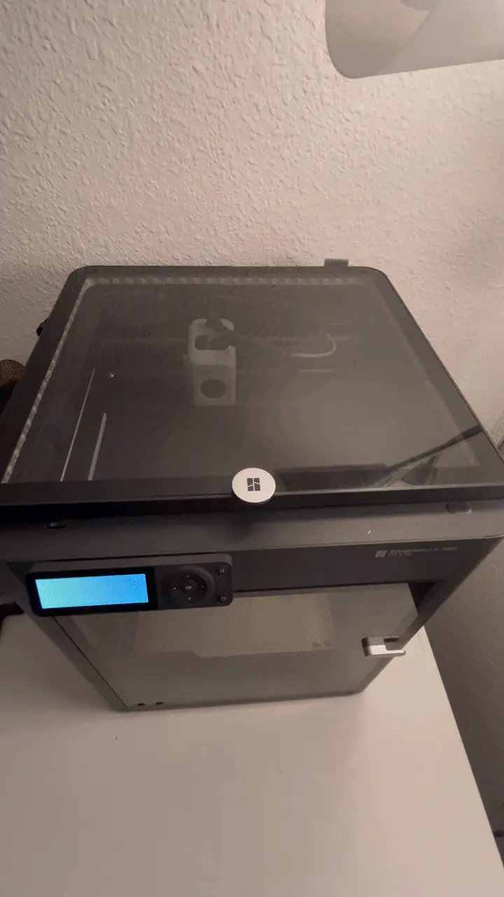
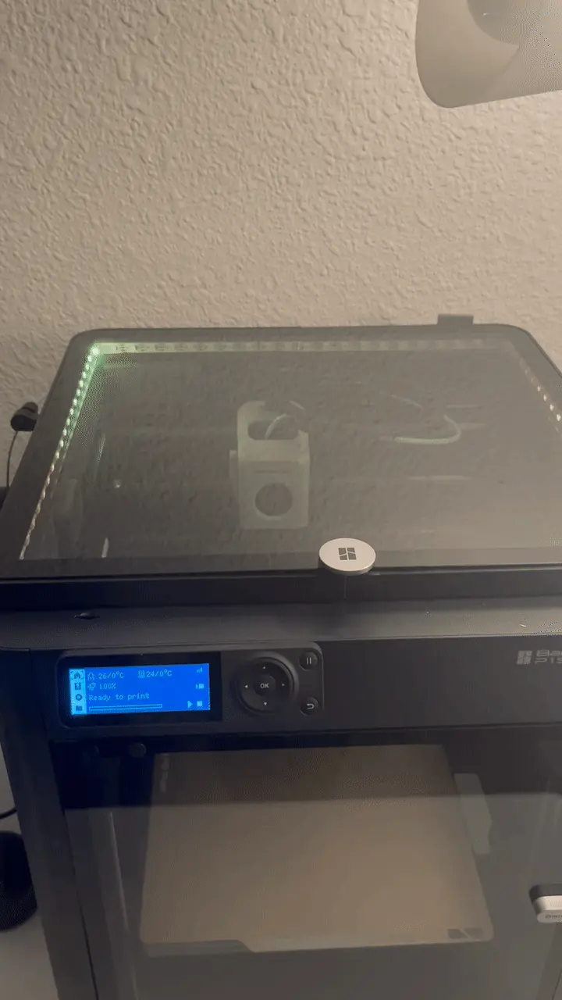
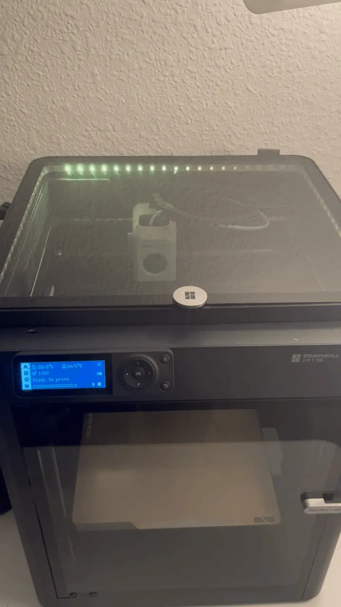
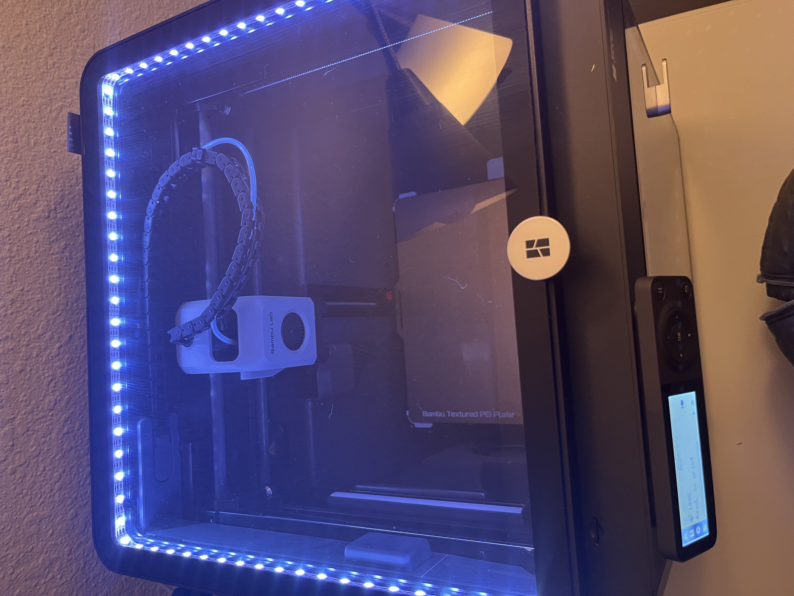
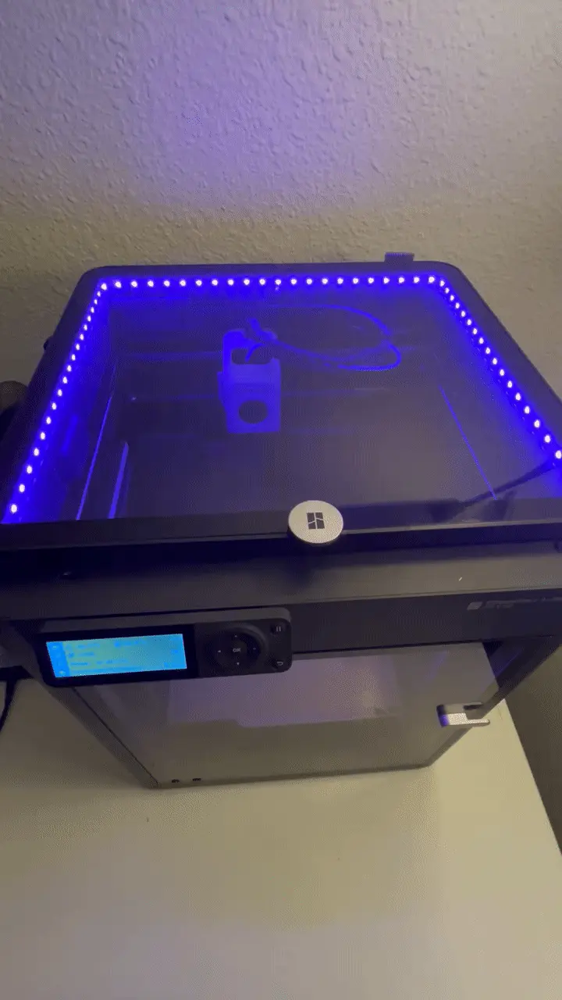
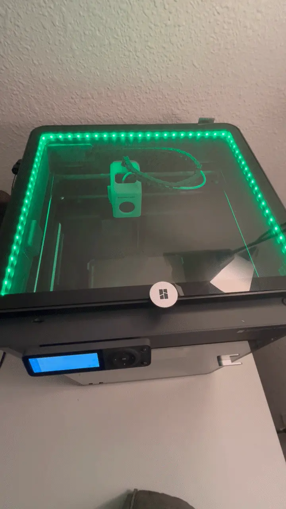

# Bambu P1S LED & Voice Controller

Image of pcb here

## Introduction
Overview of project function
Objectives and Goals, mention that this is still in progress

## Required Hardware
provide the pcb design images, maybe files

### Powering 
how does the pcb get power from the printer

## Features
list the capabilites

### Startup&emsp;&emsp;&emsp;&emsp;&emsp;&emsp;&emsp;&emsp;&emsp;&emsp;&emsp;&emsp;&emsp;Loading Filament&emsp;&emsp;&emsp;&emsp;&emsp;&emsp;&emsp;&emsp; Unloading Filament
  &emsp;&emsp;&emsp;&emsp;   &emsp;&emsp;&emsp;&emsp; 

### Printing&emsp;&emsp;&emsp;&emsp;&emsp;&emsp;&emsp;&emsp;&emsp;&emsp;&emsp;&emsp;&emsp;&emsp;&emsp;&emsp;&emsp;Standby&emsp;&emsp;&emsp;&emsp;&emsp;&emsp;&emsp;&emsp;&emsp;&emsp;&emsp;&emsp; Print Finished
  &emsp;&emsp;&emsp;&emsp;   &emsp;&emsp;&emsp;&emsp; 

## Installation
briefly explain how the code aspect works

explain what's needed to run the code
